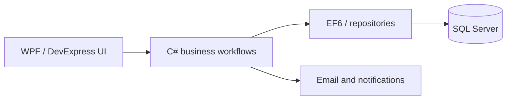

# Talha Javed — Software Engineering Portfolio

**Software Engineer | C# · .NET · ASP.NET Core · SQL Server · Enterprise Applications**

[Live portfolio](https://talhajavedawan.github.io/portfolio/) · [CV](https://talhajavedawan.github.io/portfolio/cv/Talha_Javed_CV.pdf) · [LinkedIn](https://www.linkedin.com/in/talha-javed-013319173/)

## Overview

I have 6+ years of experience building and supporting business-critical applications. At MicroKosm, I progressed through software engineering and technical product responsibilities while working on a customised ERP supporting approximately 200–250 users across nine businesses.

This repository contains the portfolio website, a documented commercial ERP case study, and **independent illustrative C# examples with unit tests**. It does **not** contain the proprietary production ERP source code.

## Commercial project: Customised ERP

**Stack:** C# · .NET Framework 4.6/4.8 · WPF/XAML · DevExpress · Entity Framework 6 · SQL Server

**Modules and business areas:** finance and accounting, sales, procurement, inventory, administrative expenses, reporting, company/department management and permission-controlled workflows.

**Selected engineering contributions:**
- Built and maintained business workflows across finance, procurement and inventory modules.
- Investigated EF entity-tracking conflicts, data-integrity issues, performance problems and memory pressure in long-running desktop sessions.
- Implemented centrally managed 15-minute inactivity sign-out across 100+ application windows.
- Coordinated five graduate developers contributing to ASP.NET Core Web API and Angular ERP modernisation features.

[Read the full case study](docs/CASE-STUDY.md) · [Architecture and migration approach](docs/ARCHITECTURE.md) · [Engineering challenges](docs/ENGINEERING-CHALLENGES.md)

### Architecture at a glance

The [architecture document](docs/ARCHITECTURE.md) also describes the planned incremental migration toward ASP.NET Core APIs, Angular and EF Core. The target design is not presented as a fully deployed replacement.

## Review actual code and tests

These small, independently authored examples demonstrate domain modelling and automated testing. They are **not** extracts from the commercial ERP.

| Example | Implementation | Tests | Demonstrates |
|---|---|---|---|
| Cash flow calculation | [C# service](src/SmartERP.Showcase/CashFlowSummaryService.cs) | [xUnit tests](tests/SmartERP.Showcase.Tests/CashFlowSummaryServiceTests.cs) | Financial calculations and testable service logic |
| Approval workflow | [C# workflow](src/SmartERP.Showcase/ApprovalWorkflow.cs) | [xUnit tests](tests/SmartERP.Showcase.Tests/ApprovalWorkflowTests.cs) | State transitions, validation and failure paths |

For build and test commands, inspect the sample projects under [src](src/) and [tests](tests/); use the .NET SDK version required by their project files.

## Visual evidence

[View the ERP dashboard screenshot](https://talhajavedawan.github.io/portfolio/images/MainDashboard.PNG). Additional production screenshots are not published without checking confidentiality and disclosure permissions.

## Documentation

- [Case study — business context, responsibilities and outcomes](docs/CASE-STUDY.md)
- [Architecture — desktop system and proposed web modernisation](docs/ARCHITECTURE.md)
- [Engineering challenges — EF, memory, session security and permission trees](docs/ENGINEERING-CHALLENGES.md)
- [Security and confidentiality boundaries](SECURITY.md)

## About this repository

The public samples are intentionally separated from proprietary application code, client records, credentials and private infrastructure. For my broader experience and project presentation, visit the [portfolio website](https://talhajavedawan.github.io/portfolio/).
